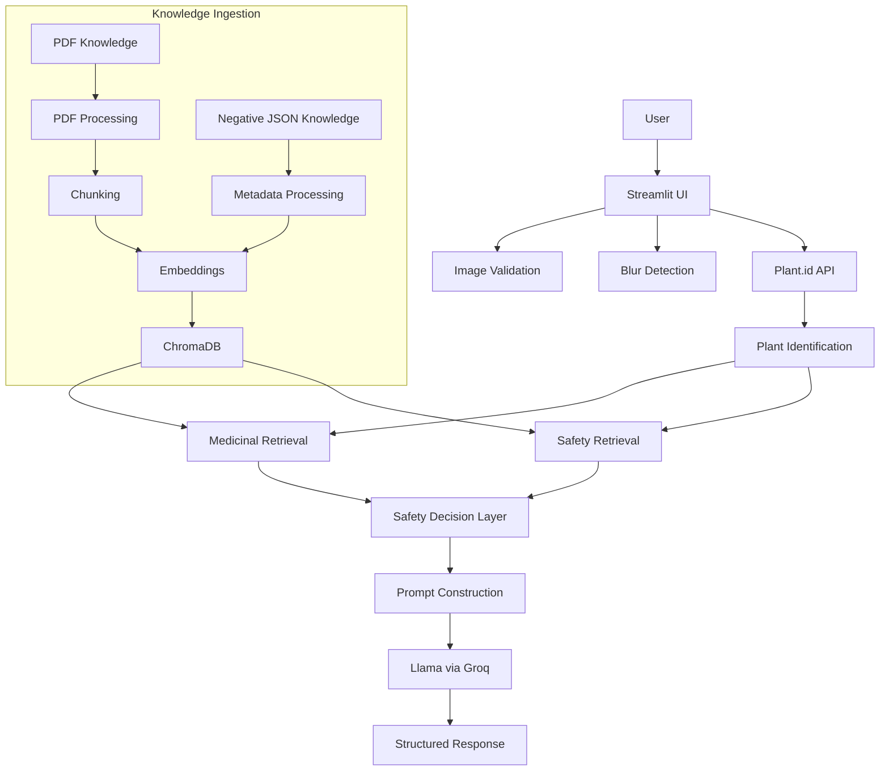
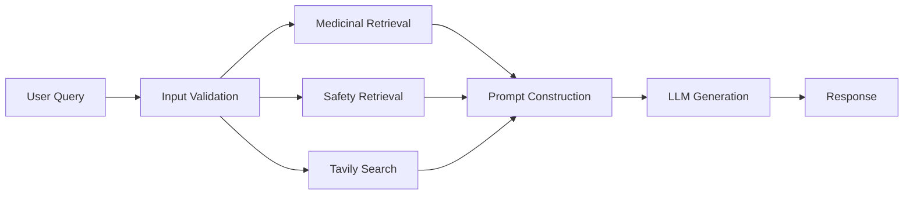

# Phytobot

## Overview

Phytobot is an AI-powered botanical assistant that combines computer vision, retrieval-augmented generation (RAG), and safety-aware knowledge retrieval to help users identify plants and access medicinal information from authoritative sources. The system integrates plant identification with evidence-based herbal knowledge retrieval while explicitly separating botanical identification from medicinal safety assessment.

Users can upload plant images for identification or ask questions about medicinal herbs, symptoms, and traditional remedies. Phytobot retrieves information from WHO monographs, botanical encyclopedias, and curated safety databases, then uses an LLM to generate structured responses that clearly distinguish between authoritative evidence and traditional use. The system is designed for educational purposes and includes multiple safety layers to highlight potential toxicity, dangerous look-alikes, and contraindications.

## Problem

Simple plant identification systems are insufficient for safe botanical use. Identification alone does not establish medicinal safety—many plants have toxic parts, dangerous look-alikes, or context-dependent safety profiles. Botanical and medicinal information is often distributed across large PDF documents and specialized literature, making it difficult for users to access structured, evidence-based information. Users may encounter toxic plants or dangerous look-alikes without adequate warning, and traditional use should not be automatically treated as evidence of safety. There is a need for a system that provides structured access to both botanical knowledge and safety information while clearly distinguishing between authoritative evidence and anecdotal use.

## Solution

Phytobot addresses these challenges through a multi-layered architecture:

**Plant Identification**: Computer vision via Plant.id API with blur detection to ensure image quality before identification.

**Image Quality Validation**: OpenCV-based blur detection rejects poor-quality images before API calls.

**RAG Pipeline**: Retrieval-augmented generation with separate retrieval channels for medicinal evidence and safety-negative evidence.

**Medicinal Knowledge**: WHO monographs and herbal encyclopedia data ingested from PDFs, chunked, and embedded into ChromaDB.

**Safety / Negative Knowledge**: Structured JSON knowledge base containing toxic plants, toxic parts, dangerous look-alikes, and contraindications.

**Deterministic Safety Decision Layer**: Application logic evaluates safety evidence before LLM response generation, applying mandatory warnings for critical/high-risk plants and dangerous look-alikes.

**LLM Integration**: Llama 3.1-8b-instant via Groq generates structured responses with explicit safety blocks and medical disclaimers.

**Web Search Fallback**: Tavily search provides supplementary information when local knowledge is insufficient.

The safety architecture explicitly separates plant identification from medicinal safety assessment—identification confidence is not used as a safety score. The negative knowledge base contains curated toxicity information, but it is not exhaustive.

## Architecture

Phytobot is a monolithic Streamlit application with the following components:

- **Application Layer**: Streamlit UI (`app.py`) with two-tab interface for plant identification and text queries
- **Vision Module**: Plant identification via Plant.id API with blur detection (`src/vision_module.py`)
- **Knowledge Retrieval**: Separate retrieval channels for medicinal and safety evidence from ChromaDB (`src/bot_logic.py`)
- **Safety Layer**: Deterministic safety decision logic before LLM generation (`src/safety_decision.py`)
- **Knowledge Ingestion**: PDF and JSON processing with chunking and embedding generation (`src/processor.py`)
- **Configuration**: Centralized configuration with environment variable validation (`src/config.py`)
- **Validation**: Input validation for text and images (`src/validation.py`)

The system uses ChromaDB for vector storage, all-MiniLM-L6-v2 for embeddings, and Groq for LLM inference. The vector database is pre-built and committed to Git to avoid build-time resource constraints on Streamlit Community Cloud.

For detailed architecture documentation, see [docs/architecture.md](docs/architecture.md).



## Tech Stack

| Category         | Technology                          | Purpose                     |
| ---------------- | ----------------------------------- | --------------------------- |
| Language         | Python 3.12                         | Application logic           |
| UI               | Streamlit                           | Web interface               |
| Vision           | Plant.id API v3                     | Plant identification        |
| Image Processing | OpenCV (opencv-python-headless)     | Blur detection              |
| LLM              | Llama 3.1-8b-instant (configurable) | Response generation         |
| LLM Provider     | Groq                                | LLM inference               |
| RAG Framework    | LangChain                           | Retrieval and orchestration |
| Embeddings       | all-MiniLM-L6-v2                    | Semantic embeddings         |
| Vector Database  | ChromaDB                            | Knowledge retrieval         |
| Web Search       | Tavily                              | External search             |
| PDF Processing   | PyPDFLoader (LangChain)             | Knowledge ingestion         |
| Testing          | pytest                              | Automated testing           |

**Core Dependencies**:

- `numpy==1.26.4`, `opencv-python-headless==4.11.0.86` (environment fixes)
- `torch==2.2.2`, `transformers==4.40.0`, `sentence-transformers==2.7.0` (AI/ML)
- `langchain`, `langchain-community`, `langchain-groq`, `langchain-chroma` (RAG)
- `streamlit`, `python-dotenv`, `pillow` (UI and utilities)

## Key Features

- **Plant Identification**: Upload plant images for identification via Plant.id API with confidence scores
- **Image Quality Validation**: OpenCV-based blur detection rejects blurry images before identification
- **"Not a Plant" Detection**: Identifies when uploaded images do not contain plants
- **Medicinal Knowledge Retrieval**: Retrieves information from WHO monographs and herbal encyclopedia
- **Safety-Negative Knowledge**: Curated database of toxic plants, toxic parts, and dangerous look-alikes
- **Separate Retrieval Channels**: Medicinal evidence and safety evidence retrieved independently with metadata filtering
- **Deterministic Safety Decision Layer**: Application logic evaluates safety evidence before LLM response generation
- **Mandatory Safety Warnings**: Critical and high-risk plants trigger mandatory warnings before any medicinal information
- **LLM-Generated Structured Responses**: Llama 3.1 generates responses with explicit safety status blocks
- **Web Search Fallback**: Tavily search provides supplementary information when local knowledge is insufficient
- **Source Metadata Display**: Shows PDF sources and page numbers for retrieved information
- **Safety Disclaimer Enforcement**: Automatic medical disclaimers on all responses
- **Input Validation**: Text and image input validation with size limits and format checks
- **Error Handling**: Comprehensive error handling for API failures and timeouts
- **Logging**: Structured logging for debugging and monitoring

## AI Architecture

Phytobot uses AI in three distinct areas:

**Vision AI**: Plant identification via Plant.id API v3. Images are encoded as Base64 and sent with optional geographic coordinates. The API returns plant classifications with probability scores. Before identification, OpenCV calculates the Laplacian variance to detect blur—images below the threshold (default: 70) are rejected. The system also checks if the image contains a plant via the `is_plant.binary` field.

**Embeddings**: The system uses the all-MiniLM-L6-v2 model to generate semantic embeddings. Document chunks from PDFs and negative knowledge entries are converted into 384-dimensional vectors, enabling semantic similarity search in ChromaDB. Embeddings are generated during knowledge ingestion and cached for efficient retrieval.

**RAG**: PDF knowledge ingestion uses PyPDFLoader to extract text from WHO monographs and herbal encyclopedia documents. Text is split into chunks (1000 characters with 200-character overlap) using RecursiveCharacterTextSplitter. Chunks are embedded and stored in ChromaDB with metadata marking them as medicinal knowledge. Negative knowledge from JSON files is similarly processed with structured metadata including risk levels, safety status, and categories (toxic_plant, toxic_parts, dangerous_look_alike). Retrieval uses metadata filters to separate medicinal and safety channels, with top-k retrieval (k=3 for medicinal, k=3 for safety).

**LLM**: Llama 3.1-8b-instant is hosted via Groq with temperature 0.1 for consistent responses. The prompt includes structured safety rules, retrieved medicinal context, safety context, web search results, and system-generated safety warnings. The LLM is instructed to follow critical safety rules: never infer medicinal safety from identification alone, never ignore toxicity information, distinguish traditional use from authoritative evidence, and prioritize safety warnings. The response structure includes plant identification, safety status, verified WHO/encyclopedia data, safety evidence, internet research, and a mandatory disclaimer block.

**Safety Decision Layer**: Deterministic application logic in `src/safety_decision.py` evaluates safety evidence before the LLM generates the final response. The logic applies priority-ordered rules: dangerous look-alikes trigger the highest priority warnings, followed by critical/high toxicity, then caution_required status. Identification confidence below 70% triggers mandatory warnings. The system defaults to unsafe when evidence is insufficient. This deterministic layer ensures safety decisions are not delegated to the LLM.

For detailed AI architecture documentation, see [docs/ai-architecture.md](docs/ai-architecture.md).

## RAG Pipeline

Phytobot implements a complete Retrieval-Augmented Generation (RAG) pipeline with the following verified stages:

1. **Knowledge Document Acquisition**: PDFs from `data/` (WHO monographs, herbal encyclopedia) and JSON files from `data/negative/` (toxic plants, toxic parts, look-alikes)
2. **Document Parsing**: PyPDFLoader for PDFs, standard JSON parsing for safety knowledge
3. **Document Chunking**: RecursiveCharacterTextSplitter with 1000-character chunks and 200-character overlap
4. **Embedding Generation**: all-MiniLM-L6-v2 model (384-dimensional vectors)
5. **Embedding Storage**: ChromaDB with metadata (knowledge_type, risk_level, safety_status, etc.)
6. **User Query Processing**: Input validation (text length, image size/quality)
7. **Semantic Retrieval**: Separate retrieval channels with metadata filtering (medicinal vs safety)
8. **Ranking**: Top-k retrieval (k=3 for each channel) based on cosine similarity
9. **Context Construction**: Concatenation of retrieved documents into context strings
10. **Context Augmentation**: Injection of medicinal context, safety context, and web context into LLM prompt
11. **Answer Generation**: LLM generates structured response using augmented prompt
12. **Source Attribution**: PDF source and page number displayed to users

The system does not implement reranking, hybrid search, or grounding checks. Web search is treated as supplementary low-confidence evidence.

For detailed RAG pipeline documentation, see [docs/rag-pipeline.md](docs/rag-pipeline.md).

## Data Flow

### Image Workflow


### Text Workflow



## Knowledge Sources

**Medicinal Knowledge**:

- WHO monographs on selected medicinal plants (4 volumes) - Authoritative PDF documents
- The Encyclopedia of Herbal Medicine by Andrew Chevallier - Authoritative PDF document
- Source type: Authoritative PDF
- Storage: Local `data/` directory, ingested into ChromaDB

**Safety/Negative Knowledge**:

- Toxic plants database - Structured JSON
- Toxic parts database - Structured JSON
- Dangerous look-alikes database - Structured JSON
- Source type: Authoritative compilation
- Storage: Local `data/negative/` directory, ingested into ChromaDB
- Metadata: Includes risk_level, safety_status, category, evidence_quality

**Web Search**:

- Tavily search API - General web search
- Source type: Unvetted internet content
- Trust level: Low confidence
- Used as supplementary information only

**Knowledge Characteristics**:

- Medicinal knowledge: Static, authoritative, curated
- Safety knowledge: Static, authoritative, curated (but not exhaustive)
- Web search: Dynamic, unvetted, low confidence

The negative knowledge base is not exhaustive. Users should always err on the side of caution when dealing with plant identification and safety.

## Testing

The test suite includes 118 tests covering configuration, validation, safety logic, vision module, bot logic, and evidence state management.

**Test Framework**: pytest

**Test Execution Results** (2026-10-14):

- **Collected**: 118 tests
- **Passed**: 118 tests
- **Failed**: 0 tests
- **Skipped**: 0 tests
- **Warnings**: 2 deprecation warnings (LangChain pydantic v1 compatibility, pytest-asyncio configuration)

**Test Coverage**:

- Configuration validation (API, vector DB, LLM, vision, search, text, safety)
- Negative knowledge loading and entry conversion
- Safety disclaimer verification
- Safety decision logic (8 comprehensive scenarios including toxicity, look-alikes, low confidence)
- Conflict detection between medicinal and safety evidence
- Input validation (text length, image size, format verification)
- Vision module (blur detection, plant identification, API error handling)
- Bot logic orchestration (response generation, error handling, evidence states)
- Session state caching
- Session-based rate limiting (14 tests)
- AI safety and prompt injection regression tests (26 tests)

**External APIs**: Plant.id, Tavily, and Groq are mocked in tests. Tests do not require real API keys.

**CI/CD**: GitHub Actions workflow runs pytest on every push and pull request to the main branch.

**Limitations**: No end-to-end tests, no retrieval quality evaluation, no LLM response accuracy evaluation, no code coverage measurement.

For detailed testing documentation, see [docs/testing-and-verification.md](docs/testing-and-verification.md).

## Security

**Secrets Management**:

- Local development: API keys stored in `.env` file (gitignored)
- Production (Streamlit Community Cloud): Environment variables provided by platform secrets management
- All API keys loaded via environment variables, never hardcoded

**Input Validation**:

- Text input length limited to 1000 characters
- Image uploads validated for size (10MB max) and format (jpg, jpeg, png)
- Actual image content verified using PIL to prevent format mismatches

**API Security**:

- All external API calls have configured timeouts (30s for Plant.id, 30s for Groq, 15s for Tavily)
- Comprehensive error handling prevents sensitive information leakage
- No secrets or sensitive data logged

**Safety Controls**:

- Deterministic safety decision layer runs before LLM generation
- Safety warnings mandatory for critical/high-risk plants
- Medical disclaimer enforced on all responses
- Identification confidence not used as safety score

**Limitations**:

- No user authentication or authorization
- Session-based rate limiting only (no global or IP-based rate limiting)
- GitHub Dependabot configured but owner must enable alerts
- Prompt injection tests cover deterministic safety layer, not LLM itself
- No LLM output validation beyond disclaimers
- No security headers or CORS configuration (managed by platform)

For detailed security documentation, see [docs/security.md](docs/security.md).

## Deployment

**Primary Deployment**: Streamlit Community Cloud

**Deployment Architecture**:

```
GitHub Repository → Streamlit Community Cloud → Phytobot Application
```

**Deployment Steps**:

1. Code pushed to GitHub with `app.py`, `requirements.txt`, `data/`, `data/negative/`, and pre-built `vector_db/`
2. Repository connected to Streamlit Community Cloud
3. Main branch and `app.py` selected
4. Secrets configured in Streamlit app settings (GROQ_API_KEY, PLANTID_API_KEY, TAVILY_API_KEY)
5. Python version set to 3.12 in Advanced settings

**Vector Database Strategy**:

- Pre-built `vector_db/` directory committed to Git
- Includes all embeddings from WHO monographs, herbal encyclopedia, and negative knowledge
- No build step required at deployment time
- Ensures fast, reliable startup on Streamlit Community Cloud

**Knowledge Base Rebuild**:

```bash
python src/processor.py
git add vector_db/
git commit -m "Update vector database"
git push
```

**CI/CD**: GitHub Actions workflow runs pytest on every push and pull request to main branch as a quality gate. Does not handle deployment.

**Docker**: Dockerfile available for local development or alternative deployment platforms. Builds vector database during image build with `BUILDING_VECTOR_DB=1` to skip startup validation.

**Live Demo**: Not yet available. Deployment to Streamlit Community Cloud is pending.

For detailed deployment documentation, see [docs/deployment.md](docs/deployment.md).

## Screenshots

Screenshots will be added after the first public deployment.

## Live Demo

Live demo: Not yet available. Deployment to Streamlit Community Cloud is pending.

To run locally:

1. Clone the repository
2. Install dependencies: `pip install -r requirements.txt`
3. Build vector database: `python src/processor.py`
4. Configure API keys in `.env` file
5. Run: `streamlit run app.py`

## Engineering Challenges

- **Multi-API Integration**: Coordinating Plant.id (vision), Groq (LLM), and Tavily (search) APIs with different rate limits, timeout requirements, and error handling patterns
- **Image Quality Validation**: Implementing blur detection with OpenCV to reject poor-quality images before API calls, reducing costs and improving identification accuracy
- **RAG Pipeline Design**: Designing separate retrieval channels for medicinal and safety evidence with metadata filtering to ensure appropriate context for each
- **ChromaDB Ingestion**: Handling large PDF knowledge ingestion with batch processing (5000 chunks per batch) to avoid ChromaDB batch-size limitations
- **Large PDF Processing**: Processing multi-volume WHO monographs and a large herbal encyclopedia (65MB+) with efficient chunking and memory management
- **Safety-Negative Knowledge Integration**: Designing a structured JSON schema for toxic plants, toxic parts, and dangerous look-alikes with consistent metadata
- **Evidence Separation**: Distinguishing medicinal evidence from toxicity evidence in retrieval and ensuring the LLM does not conflate them
- **Deterministic Safety Logic**: Implementing priority-ordered safety rules that run before LLM generation to ensure critical warnings are never missed
- **Dependency Compatibility**: Managing compatibility between LangChain versions, Pydantic v1/v2 transition, and Python 3.12
- **Input Validation**: Implementing comprehensive validation for both text and image inputs to prevent abuse and ensure quality
- **API Failure Handling**: Designing graceful degradation when external APIs fail or timeout
- **Deployment Constraints**: Working around Streamlit Community Cloud limitations by committing a pre-built vector database to avoid build-time resource constraints

## What I Learned

Through building Phytobot, practical experience was gained with:

- **RAG Architecture**: Designing and implementing a retrieval-augmented generation pipeline with vector databases, embeddings, and metadata filtering
- **Vector Databases**: Using ChromaDB for semantic search with batch ingestion, metadata filtering, and persistence strategies
- **Embeddings**: Generating and using sentence embeddings with all-MiniLM-L6-v2 for semantic similarity search
- **Document Chunking**: Implementing recursive character text splitting with overlap for large PDF processing
- **LLM Orchestration**: Integrating Llama 3.1 via Groq with structured prompts, temperature control, and safety rules
- **Multimodal Integration**: Combining computer vision (Plant.id) with text-based RAG for a multimodal application
- **External API Handling**: Managing multiple external APIs with timeout handling, error recovery, and rate limit awareness
- **Safety-Aware AI Design**: Implementing deterministic safety logic separate from LLM generation to ensure critical warnings are never missed
- **Testing AI Integrations**: Writing comprehensive tests for AI components with mocked external APIs
- **Configuration Management**: Centralizing configuration with environment-specific handling for local development and production
- **GitHub CI**: Setting up continuous integration with pytest for automated testing on push/PR
- **Deployment Architecture**: Designing a deployment strategy for Streamlit Community Cloud with pre-built artifacts

## Future Improvements

- **Expand Negative Safety Knowledge**: Add more toxic plants, toxic parts, and dangerous look-alikes to the negative knowledge base
- **Improve Retrieval Quality**: Implement reranking or hybrid search (keyword + semantic) to improve retrieval precision
- **Embedding Model Evaluation**: Evaluate alternative embedding models for better semantic matching in the botanical domain
- **Retrieval Evaluation**: Implement systematic evaluation of retrieval quality with ground truth queries
- **Plant Identification Validation**: Add additional validation steps for plant identification, such as cross-referencing with botanical databases
- **Comprehensive Testing**: Expand test coverage to include end-to-end integration tests and retrieval quality tests
- **Monitoring and Observability**: Add logging, metrics, and monitoring for production deployment
- **Persistent User History**: Implement user sessions and query history for better context and UX
- **Authentication**: Add user authentication for personalized features and usage tracking
- **Scalable Vector Storage**: Evaluate cloud vector database options for larger knowledge bases and horizontal scaling
- **Add Rate Limiting**: Implement per-user or IP-based rate limiting to prevent abuse
- **Add Dependency Scanning**: Configure Dependabot or Snyk for vulnerability alerts
- **Add Prompt Injection Testing**: Test the system against prompt injection attacks
- **Add LLM Output Validation**: Validate that LLM responses adhere to safety rules and are grounded in retrieved context

## AI-Assisted Development

AI coding assistants were used during development for tasks including:

- Repository analysis and code navigation
- Debugging and error resolution
- Test generation and test coverage expansion
- Implementation assistance for specific components
- Code review and refactoring suggestions
- Documentation and README improvements
- Deployment configuration troubleshooting

The project owner reviewed, tested, and decided which changes to keep. AI tools were used as part of the engineering workflow but did not independently design the system architecture or make engineering decisions.

## License

MIT License

Copyright (c) 2026 Phytobot

Permission is hereby granted, free of charge, to any person obtaining a copy of this software and associated documentation files (the "Software"), to deal in the Software without restriction, including without limitation the rights to use, copy, modify, merge, publish, distribute, sublicense, and/or sell copies of the Software, and to permit persons to whom the Software is furnished to do so, subject to the following conditions:

The above copyright notice and this permission notice shall be included in all copies or substantial portions of the Software.

THE SOFTWARE IS PROVIDED "AS IS", WITHOUT WARRANTY OF ANY KIND, EXPRESS OR IMPLIED, INCLUDING BUT NOT LIMITED TO THE WARRANTIES OF MERCHANTABILITY, FITNESS FOR A PARTICULAR PURPOSE AND NONINFRINGEMENT. IN NO EVENT SHALL THE AUTHORS OR COPYRIGHT HOLDERS BE LIABLE FOR ANY CLAIM, DAMAGES OR OTHER LIABILITY, WHETHER IN AN ACTION OF CONTRACT, TORT OR OTHERWISE, ARISING FROM, CONNECTION WITH THE SOFTWARE OR THE USE OR OTHER DEALINGS IN THE SOFTWARE.
