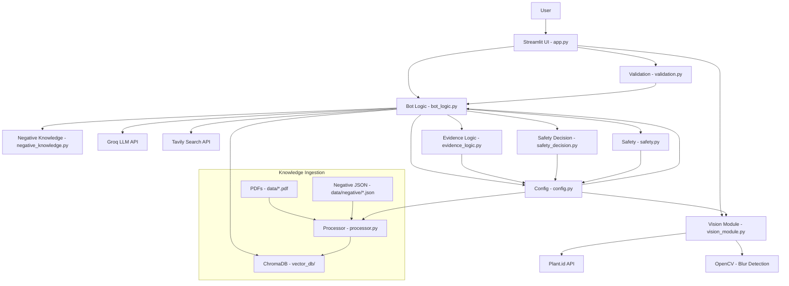

# Architecture

## System Overview

Phytobot is a web-based botanical assistant that combines computer vision, retrieval-augmented generation (RAG), and safety-aware knowledge retrieval. The system provides plant identification and evidence-based medicinal information while explicitly separating botanical identification from medicinal safety assessment.

The application is built as a monolithic Streamlit application with the following primary responsibilities:

- Plant image identification via external API
- Semantic retrieval from a local vector database
- Web search for supplementary information
- LLM-powered response generation with safety rules
- Deterministic safety decision logic before response generation

## Component Responsibilities

### Application Layer

**app.py** - Streamlit entry point and UI
- Two-tab interface: "Identify Plant" and "Symptom & Recipe Expert"
- File upload handling with session state caching
- Input validation integration
- Response rendering with source metadata display
- Startup verification for vector database existence

### Vision Module

**src/vision_module.py** - Plant identification
- Blur detection using OpenCV Laplacian variance
- Plant.id API v3 integration
- Rate limit handling with Retry-After header parsing
- Image encoding (Base64) for API transmission
- "Not a plant" detection via API response field
- Error handling for auth, network, timeout, and API errors

### Knowledge Retrieval Layer

**src/bot_logic.py** - Core orchestration
- Resource loading with Streamlit caching (embeddings, vector DB, LLM, search)
- Separate retrieval channels for medicinal and safety evidence
- Metadata-filtered retrieval from ChromaDB
- Web search integration via Tavily
- Evidence state determination
- Safety analysis and warning construction
- LLM prompt construction with safety rules
- Response generation via LangChain chain

**src/negative_knowledge.py** - Safety knowledge loading
- JSON file loading from `data/negative/`
- Structured metadata attachment (category, risk_level, safety_status)
- Document conversion for vector database ingestion
- Metadata filter generation for retrieval separation

**src/evidence_logic.py** - Evidence state management
- Evidence state determination based on retrieved documents
- Trust label generation for response display
- Input mode handling (TEXT_ONLY, IMAGE_ONLY, IMAGE_AND_TEXT)

### Safety Layer

**src/safety_decision.py** - Deterministic safety logic
- Priority-ordered safety rules before LLM generation
- Dangerous look-alike detection (highest priority)
- Toxicity level analysis (critical/high/moderate/low)
- Identification confidence threshold enforcement
- Conflict detection between medicinal and safety evidence
- Safety response formatting

**src/safety.py** - Disclaimer enforcement
- Response verification for required disclaimer phrases
- Standard disclaimer appending when missing

### Configuration Layer

**src/config.py** - Centralized configuration
- Environment variable validation
- API configuration (Groq, Plant.id, Tavily)
- Vector database configuration (path, embedding model, retrieval k)
- LLM configuration (model name, temperature, retries)
- Vision configuration (blur threshold, image size limits)
- Search configuration (max web results)
- Text processing configuration (chunk size, overlap)
- Safety configuration (thresholds, disclaimer phrases)
- Negative knowledge configuration (data path, metadata keys)
- Input mode enumeration

### Validation Layer

**src/validation.py** - Input validation
- Text input validation (length, whitespace)
- Image file validation (size, format, content verification)
- PIL-based image content verification

### Knowledge Ingestion

**src/processor.py** - Vector database construction
- PDF loading from `data/` directory using PyPDFLoader
- Negative knowledge JSON loading
- Text chunking with RecursiveCharacterTextSplitter
- Embedding generation with HuggingFaceEmbeddings
- Batch ingestion to ChromaDB (5000 chunks per batch)
- Metadata attachment for knowledge type separation

## Repository Structure

```
Phytobot/
├── app.py                      # Streamlit entry point
├── requirements.txt            # Python dependencies
├── pytest.ini                  # Test configuration
├── Dockerfile                  # Docker containerization
├── .env.example                # Environment variable template
├── .github/
│   └── workflows/
│       └── deploy.yml          # CI workflow
├── .streamlit/
│   └── config.toml             # Streamlit configuration
├── src/
│   ├── __init__.py
│   ├── config.py               # Centralized configuration
│   ├── bot_logic.py            # Core orchestration and retrieval
│   ├── vision_module.py        # Plant identification
│   ├── negative_knowledge.py    # Safety knowledge loading
│   ├── evidence_logic.py       # Evidence state management
│   ├── safety_decision.py      # Deterministic safety logic
│   ├── safety.py               # Disclaimer enforcement
│   ├── validation.py           # Input validation
│   └── processor.py            # Knowledge ingestion
├── tests/
│   ├── __init__.py
│   ├── test_app_session_state.py
│   ├── test_bot_logic.py
│   ├── test_config.py
│   ├── test_evidence_logic.py
│   ├── test_negative_knowledge.py
│   ├── test_safety.py
│   ├── test_safety_decision.py
│   ├── test_validation.py
│   └── test_vision_module.py
├── data/
│   ├── *.pdf                   # WHO monographs and herbal encyclopedia
│   └── negative/
│       ├── README.md
│       ├── toxic_plants.json
│       ├── toxic_parts.json
│       └── look_alikes.json
├── vector_db/                  # Pre-built ChromaDB (committed to Git)
└── docs/                       # Documentation (this directory)
```

## External Service Integrations

### Plant.id API
- **Purpose**: Plant identification from images
- **Endpoint**: `https://api.plant.id/v3/identification`
- **Authentication**: API key header
- **Rate Limiting**: 429 response with Retry-After header handling
- **Timeout**: 30 seconds
- **Implementation**: `src/vision_module.py`

### Groq API
- **Purpose**: LLM inference (Llama 3.1-8b-instant)
- **Model**: Configurable via `GROQ_MODEL` environment variable (default: `openai/gpt-oss-20b`)
- **Authentication**: API key
- **Timeout**: 30 seconds
- **Implementation**: LangChain `ChatGroq` in `src/bot_logic.py`

### Tavily Search API
- **Purpose**: Web search for supplementary information
- **Authentication**: API key
- **Max Results**: 2 (configurable)
- **Timeout**: 15 seconds
- **Implementation**: LangChain `TavilySearchResults` in `src/bot_logic.py`

## Persistence and Data Storage

### Vector Database (ChromaDB)
- **Location**: `./vector_db` (configurable via `VECTOR_DB_PATH`)
- **Persistence**: Disk-based persistence
- **Embedding Model**: all-MiniLM-L6-v2 (384-dimensional vectors)
- **Deployment Strategy**: Pre-built database committed to Git to avoid build-time resource constraints on Streamlit Community Cloud
- **Rebuild Process**: Run `python src/processor.py` locally after updating knowledge base

### Knowledge Sources
- **Medicinal Knowledge**: WHO monographs (4 volumes) and herbal encyclopedia PDF in `data/`
- **Safety Knowledge**: Structured JSON files in `data/negative/` (toxic plants, toxic parts, look-alikes)
- **Source Attribution**: PDF metadata includes source filename and page numbers

### Session State
- **Purpose**: Cache plant identification results to avoid duplicate API calls on Streamlit reruns
- **Implementation**: Streamlit `st.session_state` with file-based keys
- **Scope**: Per-user session (Streamlit-managed)

## Component Communication and Dependencies



## Important Design Decisions

### 1. Pre-built Vector Database
- **Decision**: Commit pre-built ChromaDB to Git instead of building at deployment time
- **Rationale**: Streamlit Community Cloud has resource constraints for large embedding generation jobs. Pre-building locally ensures fast, reliable startup.
- **Trade-off**: Larger repository size; must rebuild manually after knowledge base updates.

### 2. Separate Retrieval Channels
- **Decision**: Implement separate retrieval functions for medicinal and safety evidence with metadata filtering
- **Rationale**: Ensures safety evidence is not conflated with medicinal evidence and allows deterministic safety logic to operate on structured safety metadata.
- **Implementation**: `retrieve_medicinal_evidence()` and `retrieve_safety_evidence()` in `src/bot_logic.py`

### 3. Deterministic Safety Layer
- **Decision**: Implement application-level safety logic before LLM response generation
- **Rationale**: Critical safety warnings should not depend on LLM behavior. Priority-ordered rules ensure high-risk plants always trigger warnings.
- **Implementation**: `src/safety_decision.py` with priority order: look-alikes > critical toxicity > high toxicity > caution_required

### 4. Identification ≠ Safety
- **Decision**: Plant identification confidence is not used as a safety score
- **Rationale**: A plant can be identified with high confidence but still be toxic. Safety assessment must rely on explicit safety evidence, not identification probability.
- **Implementation**: Separate confidence threshold (70%) for identification warnings, independent of safety decision logic

### 5. Session State Caching
- **Decision**: Cache plant identification results in Streamlit session state using file-based keys
- **Rationale**: Streamlit reruns the entire script on every interaction. Caching prevents duplicate API calls for the same image.
- **Implementation**: File key includes filename and size; cache cleared on file change

### 6. Default to Unsafe
- **Decision**: Safety decision logic defaults to `is_safe=False` when evidence is insufficient
- **Rationale**: In the absence of explicit safety evidence, the system should err on the side of caution.
- **Implementation**: Default return in `make_safety_decision()` and specific handling for medicinal-only evidence

### 7. Batch Ingestion
- **Decision**: Process vector database ingestion in batches of 5000 chunks
- **Rationale**: ChromaDB has batch size limitations. Large PDFs can generate thousands of chunks.
- **Implementation**: Loop in `src/processor.py` with `batch_size = 5000`

## Known Architectural Limitations

1. **Monolithic Architecture**: All components run in a single Streamlit application. There is no separation between frontend and backend services.

2. **No User Authentication**: No user accounts, authentication, or personalized features. All state is session-based and ephemeral.

3. **No Persistent History**: Query history and interaction logs are not persisted beyond the current session.

4. **Vector Database Size**: The pre-built vector database is committed to Git, which increases repository size. This approach does not scale to very large knowledge bases.

5. **No Monitoring/Observability**: No structured logging, metrics, or monitoring for production deployment.

6. **Synchronous API Calls**: All external API calls are synchronous. There is no asynchronous processing or background job queue.

7. **No Caching Layer**: Beyond Streamlit session state, there is no caching layer for API responses or retrieval results.

8. **Limited Scalability**: The architecture is designed for single-user or low-concurrency use cases. High concurrency would require redesign.

9. **Knowledge Base Manual Updates**: Adding new knowledge requires manual PDF/JSON updates and manual vector database rebuild.

10. **No A/B Testing or Evaluation**: No systematic evaluation of retrieval quality or LLM response accuracy.
