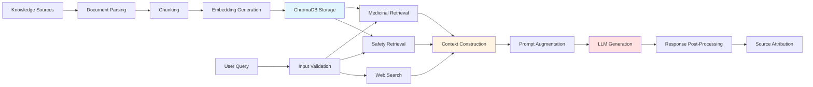

# RAG Pipeline

## RAG Implementation Status

Phytobot implements a **complete Retrieval-Augmented Generation (RAG) pipeline** with the following verified stages:

1. Knowledge document acquisition and ingestion
2. Document parsing and normalization
3. Document chunking
4. Embedding generation
5. Embedding storage and indexing
6. User query processing
7. Semantic retrieval with metadata filtering
8. Ranking (top-k)
9. Context construction
10. Augmentation of model input with retrieved context
11. Answer generation
12. Source attribution

The system does **not** implement:
- Reranking
- Hybrid search (keyword + semantic)
- Grounding checks or citation validation
- Systematic retrieval quality evaluation

## RAG Stages

### 1. Knowledge Document Acquisition and Ingestion

**Status**: ✅ Implemented

**Description**: The system ingests knowledge from two distinct sources:

1. **Medicinal Knowledge**: PDF documents from the `data/` directory
   - WHO monographs (4 volumes)
   - Herbal encyclopedia (Andrew Chevallier)

2. **Safety/Negative Knowledge**: JSON files from `data/negative/`
   - `toxic_plants.json`
   - `toxic_parts.json`
   - `look_alikes.json`

**Implementation**: `src/processor.py::process_documents()`

**Source Files**:
- PDFs: `data/*.pdf`
- Negative knowledge: `data/negative/*.json`

**Configuration**:
- Data path: `./data` (hardcoded)
- Negative data path: `./data/negative` (configured in `NegativeKnowledgeConfig.NEGATIVE_DATA_PATH`)

### 2. Document Parsing and Normalization

**Status**: ✅ Implemented

**Description**: Documents are parsed and normalized into a unified Document format.

**PDF Parsing**:
- **Tool**: LangChain `PyPDFLoader`
- **Output**: List of Document objects with page content and metadata
- **Metadata Added**:
  - `knowledge_type`: Set to `"medicinal"`
  - `source_type`: Set to `"authoritative_pdf"`
  - `source`: Original filename
  - `page`: Page number from PDF

**JSON Parsing**:
- **Tool**: Standard Python `json` module
- **Output**: List of Document objects constructed from JSON entries
- **Metadata Added**: See "Metadata Attachment" below

**Implementation**:
- PDF: `src/processor.py::process_documents()` (lines 42-51)
- JSON: `src/negative_knowledge.py::load_negative_knowledge()` and `_convert_entry_to_document()`

### 3. Document Chunking

**Status**: ✅ Implemented

**Description**: Large documents are split into smaller chunks for embedding and retrieval.

**Chunking Strategy**:
- **Tool**: LangChain `RecursiveCharacterTextSplitter`
- **Chunk Size**: 1000 characters
- **Chunk Overlap**: 200 characters
- **Separator**: Recursive (paragraphs, sentences, words)

**Implementation**: `src/processor.py::process_documents()` (lines 72-76)

**Configuration**:
- `TextConfig.CHUNK_SIZE = 1000`
- `TextConfig.CHUNK_OVERLAP = 200`

**Rationale**: Overlap ensures context continuity across chunk boundaries. Recursive splitting preserves natural text boundaries.

### 4. Embedding Generation

**Status**: ✅ Implemented

**Description**: Text chunks are converted to vector embeddings for semantic similarity search.

**Embedding Model**:
- **Model**: `all-MiniLM-L6-v2`
- **Provider**: HuggingFace sentence-transformers
- **Dimensions**: 384
- **Interface**: LangChain `HuggingFaceEmbeddings`

**Implementation**:
- Ingestion: `src/processor.py::process_documents()` (line 82)
- Retrieval: `src/bot_logic.py::load_phytobot_resources()` (line 55)

**Configuration**:
- `VectorDBConfig.EMBEDDING_MODEL = "all-MiniLM-L6-v2"`

**Caching**: Embeddings are generated during ingestion and stored in ChromaDB. No runtime embedding generation during retrieval.

### 5. Embedding Storage and Indexing

**Status**: ✅ Implemented

**Description**: Embeddings are stored in a vector database with metadata for filtering.

**Vector Database**:
- **Technology**: ChromaDB
- **Persistence**: Disk-based (persisted to `./vector_db`)
- **Interface**: LangChain `Chroma`

**Storage Strategy**:
- **Batch Size**: 5000 chunks per batch
- **Rationale**: ChromaDB has batch size limitations; large PDFs generate thousands of chunks
- **Implementation**: Loop in `src/processor.py::process_documents()` (lines 87-97)

**Metadata Attachment**:

**Medicinal Documents**:
- `knowledge_type`: `"medicinal"`
- `source_type`: `"authoritative_pdf"`
- `source`: PDF filename
- `page`: Page number

**Safety/Negative Documents**:
- `knowledge_type`: `"safety_negative"`
- `category`: `"toxic_plant"`, `"toxic_parts"`, or `"dangerous_look_alike"`
- `safety_status`: `"unsafe"`, `"caution_required"`, or `"high_risk_confusion"`
- `risk_level`: `"critical"`, `"high"`, `"moderate"`, or `"low"`
- `plant_name`: Common name
- `scientific_name`: Scientific name
- `source_file`: Source JSON filename
- `source_type`: Source type from JSON metadata
- `evidence_quality`: Evidence quality rating
- `entry_id`: Unique identifier from JSON
- Optional: `dangerous_parts`, `safe_parts`, `source`

**Deployment Strategy**:
- Pre-built vector database is committed to Git
- Avoids build-time resource constraints on Streamlit Community Cloud
- Rebuild manually with `python src/processor.py` after knowledge base updates

### 6. User Query Processing

**Status**: ✅ Implemented

**Description**: User input is validated before retrieval.

**Text Input Validation**:
- **Implementation**: `src/validation.py::validate_text_input()`
- **Checks**:
  - Empty or whitespace-only input
  - Maximum length (1000 characters)
  - Whitespace normalization
- **Configuration**: `TextConfig.MAX_QUERY_LENGTH = 1000`

**Image Input Validation**:
- **Implementation**: `src/validation.py::validate_image_file()`
- **Checks**:
  - File size (10MB max)
  - File extension (jpg, jpeg, png)
  - Actual image content verification via PIL
  - Format mismatch detection
- **Configuration**:
  - `VisionConfig.MAX_IMAGE_SIZE_MB = 10`
  - `VisionConfig.ALLOWED_IMAGE_TYPES = ["jpg", "jpeg", "png"]`

**Blur Detection** (for images):
- **Implementation**: `src/vision_module.py::check_blur()`
- **Method**: OpenCV Laplacian variance
- **Threshold**: 70 (configurable)
- **Configuration**: `VisionConfig.BLUR_THRESHOLD = 70`

### 7. Semantic Retrieval with Metadata Filtering

**Status**: ✅ Implemented

**Description**: The system performs separate retrieval for medicinal and safety evidence using metadata filters.

**Retrieval Strategy**:
- **Separate Channels**: Medicinal and safety evidence retrieved independently
- **Metadata Filtering**: Uses `knowledge_type` metadata to separate channels
- **Similarity Search**: Semantic similarity via embedding cosine similarity

**Medicinal Retrieval**:
- **Implementation**: `src/bot_logic.py::retrieve_medicinal_evidence()`
- **Filter**: `{"knowledge_type": "medicinal"}`
- **Top-k**: 3 documents
- **Configuration**: `VectorDBConfig.RETRIEVAL_K = 3`

**Safety Retrieval**:
- **Implementation**: `src/bot_logic.py::retrieve_safety_evidence()`
- **Filter**: `{"knowledge_type": "safety_negative"}`
- **Top-k**: 3 documents
- **Configuration**: `NegativeKnowledgeConfig.SAFETY_RETRIEVAL_K = 3`

**Metadata Filter Functions**:
- `src/negative_knowledge.py::get_medicinal_metadata_filter()`
- `src/negative_knowledge.py::get_safety_metadata_filter()`

**Rationale**: Separate retrieval ensures safety evidence is not conflated with medicinal evidence and enables deterministic safety logic.

### 8. Ranking

**Status**: ✅ Implemented (Top-k Retrieval)

**Description**: The system uses top-k retrieval based on semantic similarity scores.

**Ranking Method**:
- **Metric**: Cosine similarity (ChromaDB default)
- **Ranking**: Documents ranked by similarity to query embedding
- **Selection**: Top-k documents selected

**Ranking Parameters**:
- Medicinal: k=3
- Safety: k=3

**Reranking**: ❌ Not implemented

**Hybrid Search**: ❌ Not implemented (pure semantic search)

**Implementation**: ChromaDB internal ranking (no custom ranking logic)

### 9. Context Construction

**Status**: ✅ Implemented

**Description**: Retrieved documents are combined into context strings for LLM input.

**Context Sources**:
1. **Medicinal Context**: Concatenated page_content from medicinal documents
2. **Safety Context**: Concatenated page_content from safety documents
3. **Web Context**: String representation of Tavily search results

**Implementation**: `src/bot_logic.py::get_phytobot_response()`

**Medicinal Context Construction**:
```python
medicinal_context = "\n".join([d.page_content for d in medicinal_docs])
```

**Safety Context Construction**:
```python
safety_context = "\n".join([d.page_content for d in safety_docs])
```

**Web Context Construction**:
```python
web_context = str(web_results)
```

**Context Limits**:
- No explicit token limits on context
- Limited by retrieval k values (3+3 documents)
- Actual size depends on document chunk sizes

### 10. Augmentation of Model Input with Retrieved Context

**Status**: ✅ Implemented

**Description**: Retrieved context is injected into the LLM prompt template.

**Prompt Template**: `src/bot_logic.py::get_phytobot_response()`

**Context Injection Points**:
- `{medicinal_context}`: Medicinal evidence
- `{safety_context}`: Safety evidence
- `{web_context}`: Web search results
- `{safety_warning}`: System-generated safety warning
- `{identification_warning}`: System-generated identification warning
- `{plant_info}`: Plant identification information
- `{plant_identification_section}`: Formatted plant identification section
- `{trust_label}`: Evidence state trust label

**Additional Context**:
- `{question}`: User query
- `{plant_name}`: Identified plant name (if applicable)

**Implementation**: LangChain `ChatPromptTemplate.from_template()` with variable substitution

### 11. Answer Generation

**Status**: ✅ Implemented

**Description**: The LLM generates a structured response using the augmented prompt.

**LLM Configuration**:
- **Model**: Configurable via `GROQ_MODEL` (default: `openai/gpt-oss-20b`)
- **Provider**: Groq API
- **Temperature**: 0.1 (low for consistency)
- **Max Retries**: 2
- **Interface**: LangChain `ChatGroq`

**Response Structure** (enforced via prompt):
1. Plant Identification
2. Safety Status
3. Verified WHO/Encyclopedia Data
4. Safety Evidence
5. Internet Research & Traditional Use
6. Safety & Disclaimer

**Implementation**: `src/bot_logic.py::get_phytobot_response()`

**Chain Construction**:
```python
chain = prompt | llm
response = chain.invoke({...})
```

**Post-Processing**:
- Disclaimer verification and appending (if missing)
- Implementation: `src/safety.py::verify_safety_disclaimer()`

### 12. Source Attribution

**Status**: ✅ Implemented

**Description**: Source metadata is displayed to users for transparency.

**Attribution Implementation**:
- **Location**: `app.py` (text query tab)
- **Display**: Expandable section "View PDF Sources"
- **Metadata Shown**:
  - Source filename
  - Page number

**Implementation**:
```python
with st.expander("View PDF Sources"):
    for d in docs:
        st.caption(
            f"Source: {d.metadata.get('source')} | Page: {d.metadata.get('page', 'N/A')}"
        )
```

**Coverage**:
- PDF sources: ✅ Attributed
- Safety JSON sources: ❌ Not displayed to users (internal use only)
- Web search sources: ❌ Not displayed (raw string shown in context)

**Limitation**: Source attribution is only shown for text queries, not image-based queries.

## RAG Pipeline Flow Diagram



## Separate Retrieval Channels

Phytobot implements a unique dual-channel retrieval architecture:

### Medicinal Channel
- **Purpose**: Retrieve authoritative medicinal information
- **Filter**: `knowledge_type = "medicinal"`
- **Sources**: WHO monographs, herbal encyclopedia
- **Top-k**: 3 documents
- **Use Case**: Answering questions about medicinal uses, benefits, preparations

### Safety Channel
- **Purpose**: Retrieve safety and toxicity information
- **Filter**: `knowledge_type = "safety_negative"`
- **Sources**: Toxic plants, toxic parts, look-alikes JSON
- **Top-k**: 3 documents
- **Use Case**: Safety assessment, toxicity warnings, contraindications

### Rationale
1. **Evidence Separation**: Prevents conflation of medicinal and safety evidence
2. **Deterministic Safety**: Safety logic can operate on structured safety metadata
3. **Priority Rules**: Safety warnings can be generated before LLM invocation
4. **Trust Labeling**: Evidence state can be determined based on which channels returned results

## Web Search Integration

**Status**: ✅ Implemented as Supplementary Retrieval

**Purpose**: Provide supplementary information when internal knowledge is insufficient

**Implementation**:
- **Tool**: LangChain `TavilySearchResults`
- **Max Results**: 2
- **Timeout**: 15 seconds
- **Integration**: Context injected into LLM prompt

**Evidence State Impact**:
- If no internal evidence found but web search succeeds: Evidence state = `WEB_ONLY_EVIDENCE`
- Trust label: "Web research only (Low confidence)"

**Limitations**:
- Web search results are not vetted for accuracy
- No source attribution for web results
- Treated as low-confidence source

## Known Limitations

### Missing RAG Features

1. **No Reranking**:
   - System uses top-k retrieval without reranking
   - Could improve precision with cross-encoder reranking

2. **No Hybrid Search**:
   - Pure semantic search only
   - Could improve recall with keyword + semantic hybrid

3. **No Grounding Checks**:
   - No validation that LLM response is grounded in retrieved context
   - LLM could hallucinate facts not in context

4. **No Citation Validation**:
   - No automated validation of citations
   - Relies on LLM to correctly attribute sources

5. **No Retrieval Quality Evaluation**:
   - No systematic evaluation of retrieval accuracy
   - No ground truth queries for benchmarking

### Architecture Limitations

1. **Fixed Top-k**:
   - Medicinal and safety retrieval both use k=3
   - Not adaptive based on query complexity or results quality

2. **No Query Expansion**:
   - No query rewriting or expansion
   - May miss relevant documents with different terminology

3. **No Relevance Thresholding**:
   - All top-k results used regardless of similarity score
   - Low-similarity documents may be included

4. **No Context Window Management**:
   - No explicit token limits on context
   - Could exceed model context window for large chunks

5. **Source Attribution Incomplete**:
   - Only PDF sources attributed to users
   - Safety JSON and web sources not displayed

## Future RAG Improvements

### Proposed (Not Implemented)

1. **Reranking**:
   - Implement cross-encoder reranking for improved precision
   - Re-rank top-k results before context construction

2. **Hybrid Search**:
   - Add keyword search (BM25) alongside semantic search
   - Combine scores for hybrid retrieval

3. **Adaptive Top-k**:
   - Dynamically adjust k based on query complexity
   - Use relevance thresholds to filter low-quality results

4. **Query Expansion**:
   - Implement query rewriting with botanical synonyms
   - Expand queries with scientific names

5. **Context Compression**:
   - Compress retrieved context to fit within token limits
   - Prioritize most relevant passages

6. **Citation Validation**:
   - Validate that LLM response is grounded in retrieved context
   - Flag ungrounded claims

7. **Retrieval Evaluation**:
   - Create ground truth query dataset
   - Implement systematic retrieval quality metrics
   - Evaluate precision, recall, MRR, NDCG

8. **Source Attribution Enhancement**:
   - Display safety JSON sources to users
   - Attribute web search results with URLs
   - Show source attribution for image-based queries

**Note**: These are proposed improvements and are not currently implemented.
